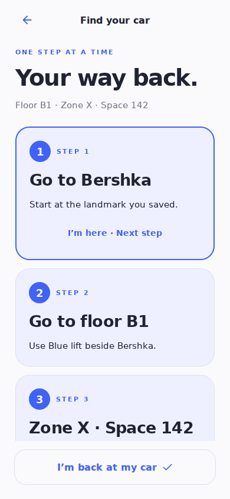

# parkd

A small, calm parking-memory app. Save your spot, add a few clues, and find your car later.

An independent project with its own application identifiers (`com.compilezen.parkd`). No Amanah Vault code, configuration, credentials, or services are used.



## Features

- One active spot, saved locally on the device.
- GPS save with permission handling and a 12-second position timeout.
- A manual option for garages and unavailable GPS.
- Camera or photo-library image, resized before local storage.
- Entrance, lift/stairs, floor, zone, parking space, and a short note.
- Large numbered “Your way back” steps, available offline, with saved progress.
- Android parking card and active-return Live Update request on supported devices.
- iOS Live Activity plus persistent Home Screen widget in signed builds.
- Selected cobalt car-in-pin logo.
- Keyboard-aware editor with a Done key and native keyboard toolbar.
- Restores the saved spot when the app reopens.
- Direct saved pin in the Maps app, with a web fallback. Choose directions from Maps.
- Confirmation before clearing the spot and photo.
- No app accounts, ads, analytics, background tracking, or server.

## Run locally

Use Node.js 24 LTS and npm.

```sh
npm ci
npm start
```

For the browser preview, run `npm run web`. Location requires HTTPS or localhost. A browser preview is useful for UI testing; validate camera, location, safe areas, and Maps handoff on actual phones before releasing.

## Checks

```sh
npm run typecheck
npm run lint
npm test
npm run test:resilience # after installing Playwright Chromium and exporting web
npm run test:ui # after installing Playwright Chromium and exporting web
npm run export:web
npm run export:mobile
```

## Android test APK

The **Android test APK** GitHub Actions workflow builds a standalone arm64 APK and attaches it to a GitHub prerelease. Download it from the repository’s Releases page. These test builds use Expo’s standard Android test key; production signing is configured separately.

## iPhone testing

See [the iPhone testing guide](docs/IPHONE-TESTING.md). For a free first test, install Expo Go, sign in to the same free Expo account on your iPhone and computer, and launch `Test-on-iPhone.cmd` from the downloaded project folder on Windows. The development preview needs a network connection and a running development server. A standalone iPhone build needs Apple signing.

## EAS builds

The `preview` EAS profile produces an installable Android APK. Connect your own Expo account and EAS project first:

```sh
npx eas-cli@latest login
npx eas-cli@latest build:configure
npx eas-cli@latest build --platform android --profile preview
```

An iOS device build needs the appropriate Apple signing setup. No store submission is performed by the test-APK workflow.

## Scope and privacy

The initial app opens the phone's Maps app; it does not embed a live map. The illustrated home card is decorative, not a map. Floor and zone are manually entered: GPS does not identify indoor levels or provide indoor navigation. GPS accuracy is shown on the find screen, and lower-accuracy fixes prompt the user to add details.

Parking details and a compressed photo are stored in AsyncStorage on the device. This is local app storage, not encrypted storage. Maps receives the saved coordinates only when the user taps Open in Maps. Device/OS backups may retain app data according to the user's backup settings. Clearing app data or uninstalling removes the app's local spot. Photo capture/manipulation may leave OS-managed temporary cache files until the operating system clears them.

## Project structure

- `src/app/`: home, editor, find, photo, and about routes.
- `src/ui.tsx`: shared white-and-cobalt visual components.
- `src/store.tsx`: loading and persistent storage.
- `src/parking.ts`: parking data validation, return steps, and map pin URLs.
- `tests/`: data and navigation unit tests.
- `docs/`: product scope, validation record, and actual UI screenshots.

## Live update testing

See [the native feature test checklist](docs/LIVE-UPDATES.md). Android chooses whether an ongoing return notification receives promoted Live Update presentation. Expo Go deliberately skips custom native features; regular screens remain testable.

## Next milestones

1. Test the build on real Android and iPhone devices.
2. Add an embedded map if it improves the save/find flow; configure map provider credentials separately.
3. Consider a parking expiry reminder after the basic flow is proven.
